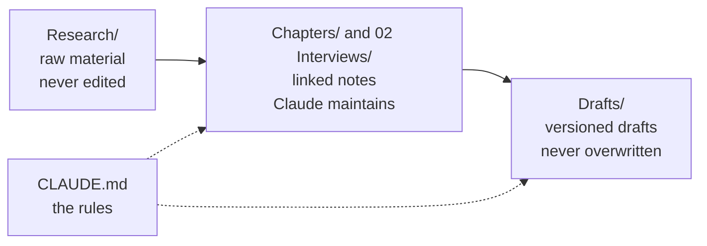
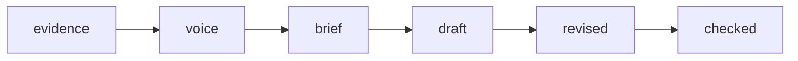

# How it works

## The idea underneath

In April 2026, Andrej Karpathy published a short idea file called [LLM Wiki](https://gist.github.com/karpathy/442a6bf555914893e9891c11519de94f): a pattern for building a personal knowledge base with an AI. Instead of asking the AI to search a pile of documents every time, you keep the raw documents untouched and let the AI write and maintain a set of linked notes on top of them. Every new source makes the notes richer, and the notes compound over time.

That's a great fit for a book. A business book is built from raw material (interviews, client stories, research, your own thinking) and the hard part is keeping all of it organized and honest across months of work. This toolkit applies Karpathy's pattern to that job, and adds the pieces a book needs: chapters, a writing pipeline, a voice, and a way to check every quote.

## Three layers of files



1. **Raw material** in `Research/`: transcripts, sources, your dictation, online posts. Claude reads these but never changes them. This is what makes the quote checker possible.
2. **Linked notes**: one note per chapter and per interview. Every shortcut writes to the same sections of the same notes, so material lands in a predictable place and the chapter grows as evidence comes in.
3. **Drafts**: written from a chapter's brief, saved as new versions, never overwritten, so you can always go back.

`CLAUDE.md` sits over all of it: the book, the reader, the rules. Claude reads it every session.

## The six layers a chapter moves through



Every chapter note has a `layer` property, and the Book Map groups chapters by it, so you can see the whole book's progress at a glance. The order matters. Evidence and your own stories come first, then a one-page brief you approve, then the draft. A draft written before the evidence reads like everyone else's book.

## Properties are what make it visible

Every note starts with a small block of properties:

```yaml
---
up: "[[00 Start Here]]"
chapter: 3
layer: brief
interviews: ["[[2026-10-01 Jane Smith|Jane Smith]]"]
sources: ["[[Research/Sources/2026 Buyer Survey - note]]"]
updated: 2026-10-28
tags: [book, chapter]
---
```

The Book Map reads these to build the dashboard. ExcaliBrain reads `up` to put the book above each chapter, and the links in `interviews` and `sources` to put the evidence around it. Graph view draws a line for every link. That's why the shortcuts always write people and sources as `[[links]]` and never as plain names.

## Why the quote checker matters

Business readers forgive a lot, but not a misquote. Every interview quote carries a timestamp, like `[07:23]`, and `check_quotes.py` confirms the exact words appear in the transcript starting on that line. Research quotes have to appear in a file in `Research/`. It prints `[]` when everything matches. Run it any time:

```
python3 -I .claude/skills/check-chapter/check_quotes.py "$PWD"
```

`/check-chapter` goes further. It hands the draft to a separate checking agent that didn't write it, so the review isn't marking its own homework.

## One job per session

Each session does one thing (ingest one interview, brief one chapter, draft one chapter) and ends with `/wrap`. That keeps Claude's working memory clean and keeps the Session Log honest, and the Session Log becomes a record of how the whole book got built.

## Making it yours

Everything is plain text, so change anything:

- **The chapter pattern and quality gate** live in `01 Planning/How We Write This Book.md`.
- **The chapter note shape** lives in `01 Planning/Chapter Template.md`.
- **The interview questions** live in `02 Interviews/Interview Guide.md`.
- **The shortcuts** are in `.claude/skills/`, one folder each with a `SKILL.md` you can read and edit. Ask Claude to change one for you; describe what you want in plain words.
